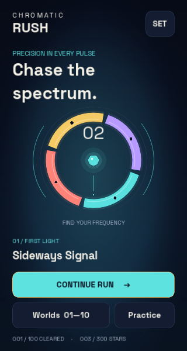
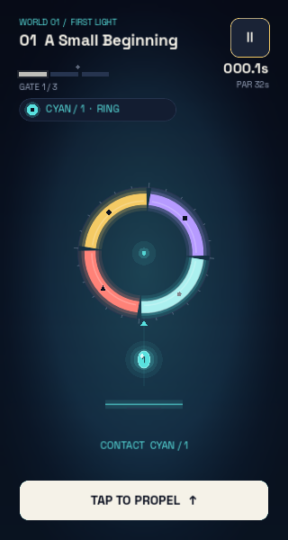

# Chromatic Rush

**Read the rhythm. Match the color. Make the next jump.**

Chromatic Rush is a native, offline arcade game about timing an orb through moving color gates.
One input controls the action, while **100 authored levels across 10 worlds** introduce new ways
to read a pattern, choose a launch and recover from a missed beat. Built with **Godot 4.7.2 and
typed GDScript**, it runs on Android with a Windows desktop preview.

[How to run](#how-to-run) ? [How to play](#how-to-play) ? [What makes it fun](#what-makes-it-fun) ?
[Architecture and flowcharts](docs/ARCHITECTURE.md) ? [Release evidence](docs/RELEASE.md)

| Home | In play |
|---|---|
|  |  |

These are captures of the running native app. More screens and verification details are in
[release verification](docs/RELEASE.md#tests-and-runtime-verification).

## What makes it fun

The challenge comes from **anticipation**: a gate must match when the orb reaches it, so the
right move is often to launch just before the opening arrives. You can wait safely on the perch,
watch a rotation, then commit. A second tap in midair can turn a short hop into a successful climb.

- **A small control set with room to improve.** Learning when to tap matters more than memorizing buttons.
- **Mechanics that change the question.** A switch changes your target color; a pulse adds an opening
  window; a chain asks for two correct contacts; a reverse field sends the route downward.
- **A campaign with its own rhythm.** Ten visual worlds build from simple rings and sliding bands
  to longer combinations. The 100 routes have explicit authored layouts and timing parameters.
- **A reason to replay.** Chase a cleaner clear, a faster personal best, three stars or all seven
  standard achievement milestones. A checkpoint limits how much of the route you repeat.
- **A way to experiment.** Practice opens the entire campaign. Optional matching-window guidance
  and slower time help you study a difficult route, with those results saved separately.
- **Feedback you can read.** Color names, numbers and shapes accompany the palette; contact flashes,
  shatter effects, synthesized chimes and optional Android haptics mark the outcome of an action.

This is the intended play experience. Automated route and timing tests verify the rules and
reachability; they do not substitute for human difficulty or enjoyment studies.

## How to run

### Play a supplied build

No Godot editor, Python, account or internet connection is needed to play an exported build.
The `builds/` folder is generated and ignored by Git; binaries are supplied separately from the
source ZIP or created with the build commands below.

| Platform | Local artifact | Start playing |
|---|---|---|
| Android release | [Signed APK](builds/chromatic-rush-1.0.0-release.apk) | Install on your Android device, then open **Chromatic Rush** from the launcher. |
| Android development | [Debug APK](builds/chromatic-rush-1.0.0-debug.apk) | Use for development/sideload testing. |
| Windows x64 | [Desktop preview](builds/ChromaticRush-1.0.0.exe) | Open the EXE; it runs without an installer. |

Android requires **Android 7.0 / API 24 or newer**, on ARM64 or x86_64. The Windows preview is
unsigned. Exact hashes, SDK declarations and signing evidence are in [RELEASE.md](docs/RELEASE.md).

With Android platform-tools and USB debugging already configured, install to your selected device:

```powershell
Set-Location -LiteralPath 'E:\New repos for portfolio\ChromaticRush'
adb devices -l
adb -s YOUR_DEVICE_SERIAL install -r .\builds\chromatic-rush-1.0.0-release.apk
```

Replace `YOUR_DEVICE_SERIAL` with the intended device from the list. Debug and release builds use
different signing certificates, so the release cannot update a debug-key installation. Removing
an old installation erases its local progress. Same-key updates use `install -r`.

### Run the source project

The supplied development scripts target Windows PowerShell and Python 3.13. Bootstrap installs
the pinned portable Godot engine outside the repository and verifies its download hash.
If you extracted the source elsewhere, change the first path to that directory.

```powershell
Set-Location -LiteralPath 'E:\New repos for portfolio\ChromaticRush'
.\scripts\bootstrap.ps1 -SkipTemplates
$env:GODOT_BIN = "$env:LOCALAPPDATA\Programs\CodexDevTools\godot\Godot_v4.7.2-stable_win64_console.exe"
& $env:GODOT_BIN --path .
```

To inspect scenes and scripts instead, open the editor and press **F5** to run the main scene:

```powershell
& $env:GODOT_BIN --editor --path .
```

`-SkipTemplates` avoids the approximately 1.3 GB export-template download for source-only play.
Before building exports, run `scripts/bootstrap.ps1` again without that switch. The engine is
installed under `%LOCALAPPDATA%\Programs\CodexDevTools\godot`; development tools live in `.tools/`.
See [toolchain details](docs/RELEASE.md#toolchain-and-compatibility) for the inspected toolchain.

## How to play

### Your first route

1. Choose **CONTINUE RUN** on the home screen. On a new installation this starts route 01,
   **A Small Beginning**; later it selects the saved standard route or first uncleared route.
2. Read your orb's identity and the contact marker on the moving gate. Match the segment the orb
   will touch, rather than an arbitrary color elsewhere on the gate.
3. Tap the arena or **TAP TO PROPEL**. On desktop you can click or press **Space**. Tap again in
   the air when you need more height; inputs have a 100 ms game-time cooldown.
4. Pass each gate on the correct color. Clearing a marked checkpoint changes where **TRY AGAIN**
   will resume. A wrong color or a closed pulse ends the attempt and explains the mismatch.
5. Finish the route, review stars/time/score, then choose **NEXT ROUTE** or replay to improve.

The route clock runs while waiting on a perch and while playing. Pause stops it. Checkpoint
retries retain elapsed time, taps and failures, so **Restart route** is the way to attempt a new
clean run from the beginning. Reopening the app restores the earned checkpoint, not a midair pose.

### Controls

| Action | Android | Windows / keyboard |
|---|---|---|
| Propel toward the exit | Tap the arena or bottom action | Click the arena/action or press **Space** |
| Propel again in the air | Tap again | Click / **Space** again |
| Pause / resume | Pause control or system **Back** | Pause control, **P** or **Escape** |
| Navigate menus | Tap a control; swipe scrolling lists | **Tab**, **Shift+Tab**, **Enter**; mouse/scroll |
| Return from a menu | On-screen back arrow or system **Back** | Back arrow or **P / Escape** |

Focus loss pauses an active run and suspends audio. Returning to the app leaves the run paused
until you resume. On Android, system Back from home exits cleanly.

### Read the four identities

| Color | Number | Shape |
|---|---:|---|
| Cyan | 1 | Circle |
| Coral | 2 | Triangle |
| Gold | 3 | Diamond |
| Iris | 4 | Square |

Shape and number cues are enabled by default. Gates use the same identities as the orb.

### Learn the seven gate mechanics

| Gate | What to do |
|---|---|
| Ring | Time your crossing through a rotating matching segment. |
| Slide | Read the moving band as its colors pass the contact point. |
| Pendulum | Follow the swinging band's changing position and pace. |
| Switch | Match first; after clearing, read the next gate using your new orb color. |
| Pulse | Cross when **both** the color matches and the pulse is open. |
| Chain | Keep lifting through two independently checked matching contacts. |
| Reverse | Follow the downward route; the same tap still propels toward the exit. |

### Choose your mode and goal

| Mode | Routes available | What is saved |
|---|---|---|
| Standard | Sequential unlocks, beginning with route 1 | Standard bests, stars, next-level unlocks and achievements |
| Practice | All 100 routes | Separate practice/assisted records; standard progression is unaffected |
| Assisted | An unlocked route started with guide or slow time enabled | Separate practice/assisted records; Next continues in practice |

Three stars require **zero failures and a time at or below par**. If that condition is missed,
up to two failures earn two stars; three or more earn one. Best stars, score and time are retained
independently, so improving one field cannot erase a better result in another.

Use **Worlds 01?10** to revisit unlocked standard routes, or **Practice** to try a later chapter.
In **SET ? Records + achievements**, inspect standard achievement progress. Settings also include
**How to play**, the in-app guide.

### Settings and comfort

Open **SET** from home (shown as **Settings** in large-text mode):

- Toggle sound effects, the world soundtrack and Android haptics independently.
- Enable **Reduce decorative motion** or keep the default shape/number color cues.
- Enable **Large text (200%)** for scrolling menus and an enlarged gameplay HUD.
- Enable **Assist: show matching windows** or **Assist: slower time (70%)** before starting a route.
- Use **Reset local progress?** only when you intend to clear records and checkpoints; confirmation
  is required and settings are preserved.

Supported OS reduce-animation requests are honored. Essential gate motion remains part of the
game. Large text is an app setting; screen-reader and automatic OS font-scale support have not
been established. See [accessibility verification](docs/RELEASE.md#accessibility-verification).

## Explore the ten worlds

| Routes | World | Campaign idea |
|---|---|---|
| 01?10 | First Light | Learn rings, sliding bands and patient launches. |
| 11?20 | Tidal Circuit | Read pendulums and easing. |
| 21?30 | Prism Orchard | Adapt after color switches. |
| 31?40 | Pulse Foundry | Combine a matching color with an open pulse. |
| 41?50 | Glass Relay | Sustain lift through chained contacts. |
| 51?60 | Inverse Sky | Follow descending reverse fields. |
| 61?70 | Ember Archive | Revisit familiar mechanics in new orders. |
| 71?80 | Ion Cathedral | Handle longer, denser relays. |
| 81?90 | Velvet Paradox | Read timing contrasts and mixed direction. |
| 91?100 | White Horizon | Bring the full set of mechanics together. |

[LEVEL_DESIGN.md](docs/LEVEL_DESIGN.md) lists individual routes and authored intent.
[balancing and performance](docs/RELEASE.md#balancing-and-performance) explains the automated timing-tolerance and retry analysis.

## Develop, verify and build

Android export additionally requires JDK 17 and an Android SDK containing platform-tools,
build-tools and a platform installation. Full bootstrap installs the export templates.

```powershell
.\scripts\bootstrap.ps1
.\scripts\check.ps1
.\scripts\test.ps1
.\scripts\quality.ps1
.\scripts\build.ps1 -Target Windows
.\scripts\build.ps1 -Target Android
```

| Command | Purpose |
|---|---|
| `check.ps1` | Pinned formatting/lint, Python compilation, level validation and native import |
| `test.ps1` | Every native `test_*.gd` suite, real-file persistence tests and all-level route search/replay |
| `quality.ps1` | Source patterns, exact-token duplication, rendered source-line/branch coverage gates |
| `balance.ps1` | Timing perturbation, launch tolerance and checkpoint recovery analysis |
| `balance.ps1 -RenderBenchmark -Stress` | Actual desktop rendering under bounded visual stress |
| `build.ps1 -Target All` | Windows export plus Android debug APK |
| `package.ps1` | Source ZIP and SHA-256 sidecar |
| `audit_release.py` | Artifact hashes, APK content and source-archive byte/CRC checks |

Logs go to `builds/logs/`. `check.ps1 -Format` applies the GDScript formatter. The check/test/build
scripts retry only silent cold-import failures, up to three attempts; diagnosed errors and test
failures are not retried. The development machine has exhibited intermittent Godot cold-import
crashes. For Android tool paths that are not auto-detected:

```powershell
.\scripts\build.ps1 -Target Android -AndroidSdkPath 'C:\path\to\android-sdk' -JavaHome 'C:\path\to\jdk-17'
```

For a signed release, restore the existing private signing identity or set the documented
`GODOT_ANDROID_KEYSTORE_RELEASE_*` environment variables, then run:

```powershell
.\scripts\build.ps1 -Target Android -SignedAndroidRelease
```

Signing material stays outside the project. Preserve and privately back up both signing files;
future updates need the same key. [RELEASE.md](docs/RELEASE.md) explains the protected local setup.
The complete release audit expects Windows, debug, signed release and source artifacts to exist:

```powershell
.\scripts\package.ps1
python .\scripts\audit_release.py
```

## How the app is built

The small native scene boots a controller that joins **authored content**, **deterministic gameplay**,
**native menus**, **original presentation/audio** and **validated local saves**. Input changes the
simulation; the renderer reads it. The route harness drives those same production rules.

```text
ChromaticRush/
??? project.godot, main.tscn, export_presets.cfg
??? assets/             Original icon/geometry identity, fonts and license notices
??? data/worlds/        Ten JSON worlds; 100 authored levels and 486 stages
??? src/app.gd          Navigation, input and persistence coordination
??? src/domain/        Registry, gate sampling, fixed-step run simulation
??? src/services/      Saves/migration, synthesized audio/haptics, accessibility adapter
??? src/ui/            Native menus/HUD, drawing, effects, world themes and large-text views
??? tests/             Rules, real-file saves, routes, UI/accessibility and rendering tools
??? scripts/           Bootstrap, checks, quality gates, balancing, exports and packaging
??? docs/              Design, architecture, content, test and release evidence
??? .github/workflows/ Windows verification/build workflow
```

Start with the **[architecture and development guide](docs/ARCHITECTURE.md)** for module ownership,
startup/navigation diagrams, the input-to-collision sequence, scoring/unlocks, save recovery,
accessibility, development milestones and the complete build/release pipeline.

## Saves, privacy and troubleshooting

Progress stays in `user://progress.json`, with temporary writes and a previous-save backup.
On Windows the normal location is `%APPDATA%\Godot\app_userdata\Chromatic Rush\`.
Android uses app-private storage. There is no account, server, cloud sync, advertising or telemetry;
only vibration permission is requested. Uninstalling removes progress and cloud backup is disabled.

| Situation | What to check |
|---|---|
| Next standard route is locked | Clear the previous route in standard mode; practice/assisted clears do not unlock it. |
| Continue does not restore an exact airborne position | Resumes restore the last earned checkpoint, color and cumulative statistics. |
| Saving warning appears | Progress remains in memory; restore available storage/folder access, then choose Retry. |
| Primary save is damaged | The loader tries the previous valid backup and explains possible recent-progress loss. |
| Android reports a signing mismatch | Debug/release keys differ. Preserve any needed progress before removing an installation. |
| Legacy emulator shows a blank arena | Recorded `swiftshader_indirect` failed shader linking; the same APK rendered with `-gpu host`. |
| Source ZIP has no playable EXE/APK | Build output is distributed separately; use the export commands above. |

## Verification and limits

The recorded release passes **12 native suites**, all **100 searched/replayed routes**, signed
Android emulator touch/Back/offline/reinstall checks, rendered large-text/UI/world checks and an
extracted-source rebuild. Recorded unique planned source-line coverage is **94.69%**, branch
coverage **90.84%**, with every production script included. Independent function/statement metrics
are unsupported; a SonarQube GDScript gate is not claimed.

Physical-phone testing was skipped at the owner's request. Phone latency/FPS/audio/haptics,
screen-reader use, human campaign balancing and remote CI execution remain unverified. The native
screenshots and emulator evidence establish the scenarios recorded in the reports, not universal
hardware or accessibility conformance.

The repository has four Markdown guides, each with one purpose:

| Guide | What it owns |
|---|---|
| This README | Running, playing, controls and quick troubleshooting |
| [Architecture and design](docs/ARCHITECTURE.md) | Development, source ownership, flowcharts and design decisions |
| [Level catalogue](docs/LEVEL_DESIGN.md) | The 100 authored routes and authoring intent |
| [Release and verification](docs/RELEASE.md) | Toolchain, builds/signing, tests, quality/balancing/accessibility evidence and known limits |

Original source, levels and geometric/audio work use the [MIT license](LICENSE).
Space Grotesk retains the [SIL Open Font License](assets/FONT-LICENSE.txt); engine notices retain
their original terms. This is a separate project; other portfolio applications are not dependencies.
