# Chromatic Rush: architecture and development guide

This guide follows the implemented v1.0 source. It explains the game in plain language first,
then traces the modules, state transitions, collision rules, saves and release process. Source
links point to the code that owns each behavior. Observed checks are in
[release verification](RELEASE.md#tests-and-runtime-verification).

**Reading path:** start with the overview, then follow the part you want to understand.
[Design rationale and reference record](#19-design-rationale-and-reference-record) is in section 19.

| Question | Jump to |
|---|---|
| How does the app fit together? | [System map](#3-system-map-and-state-ownership) and [startup](#4-entrypoint-startup-and-scene-composition) |
| What happens when I tap? | [Input sequence](#6-input-to-feedback-sequence), [run states](#7-deterministic-motion-and-the-run-state-machine), [collision](#8-collision-and-gate-rules) |
| How do levels and rewards work? | [Authored routes](#9-authored-content-and-a-concrete-route) and [progression](#10-modes-scoring-unlocks-and-achievements) |
| How is progress protected? | [Save loading](#11-save-schema-trust-boundary-and-recovery) and [writes/reset](#12-writes-failures-and-progress-reset) |
| How was it developed and checked? | [Development slices](#15-how-development-was-structured), [tests](#16-tests-route-proof-and-evidence-boundaries), [release flow](#17-build-package-and-release-flow) |
| Where should I change something? | [Extension guide](#18-change-the-app-without-breaking-its-contracts) |

The diagrams use Mermaid. GitHub and Mermaid-enabled Markdown viewers render the fenced blocks;
each also links to a generated SVG for viewers that display only source text.

## 1. The game in one minute

A route is a sequence of authored stages. The orb starts at a safe perch. The player waits for a
moving gate's correct color, taps to rise toward it, and may tap again in flight. A crossing is
accepted only if the gate is open and its contact color matches the orb **at the crossing time**.
A successful stage returns the orb to the next perch; a wrong crossing ends the attempt.

Some stages change the orb's color, require two contacts, or display downward travel. Marked
checkpoints limit replay after failure. Standard clears unlock the next route. Practice and
assisted results use a separate record collection. Everything runs locally without an account.

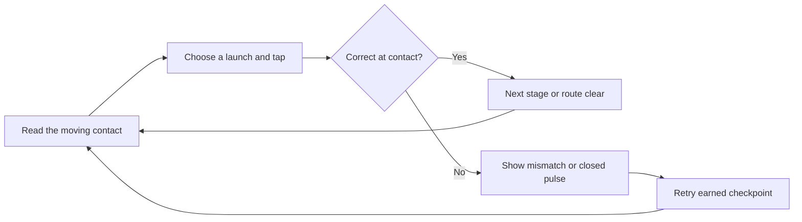

[Open the gameplay-loop diagram](diagrams/architecture-1.svg).

## 2. Stack choices and product boundaries

| Decision | Reason in this product | Tradeoff |
|---|---|---|
| Godot 4.7.2 + typed GDScript | Native input, drawing, audio and Android export in one runtime | Engine/tool versions must match; some analysis tools do not support GDScript |
| Compatibility renderer | Lightweight 2D geometry and broad intended hardware reach | Actual driver compatibility and phone FPS require runtime evidence |
| Explicit JSON worlds | Reviewable, deterministic stage parameters for 100 authored routes | Content changes require validation and route replay |
| Domain / services / UI split | Rules can be tested without menus or a renderer | Controller wiring must keep ownership boundaries clear |
| Local versioned JSON saves | Offline operation and inspectable recovery | No account recovery or cross-device sync; local records are editable |
| Programmatic native UI and drawing | A small scene composes themed menus and custom gates | Custom gameplay drawing needs additional accessibility and layout work |
| Cached synthesized sound | Original cues without downloaded audio assets | World variations share a synthesized pattern rather than full recorded tracks |

React/Capacitor and Unity were considered in the initial decision record. Godot fit the small,
fully offline native arcade scope. There is no backend, database server, WebView, external API,
telemetry or ad SDK. Exported play needs no Python, Node.js or network connection. Python and
PowerShell are development tools; optional Mermaid tooling is only for documentation.

## 3. System map and state ownership

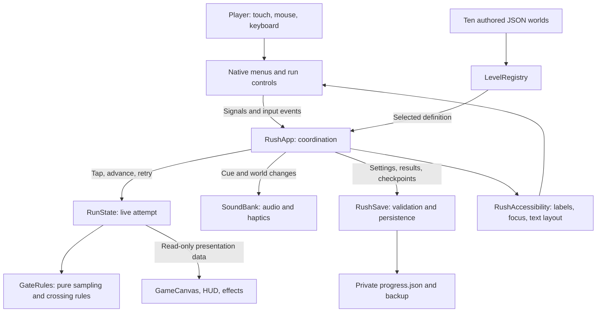

[Open the system-map diagram](diagrams/architecture-2.svg).

| Owner | Source | Owns |
|---|---|---|
| `RushApp` | [app.gd](../src/app.gd) | Screen history, input dispatch, run creation, save timing, result recording, lifecycle |
| `LevelRegistry` | [level_registry.gd](../src/domain/level_registry.gd) | Loaded dictionaries, sequential lookup and structural error collection |
| `RunState` | [run_state.gd](../src/domain/run_state.gd) | Motion, gate/contact index, clock, taps, failures, checkpoint, mode and status |
| `GateRules` | [gate_rules.gd](../src/domain/gate_rules.gd) | Identity/opening, contact count/height, crossing interpolation and assist-window search |
| `RushSave` | [save_store.gd](../src/services/save_store.gd) | Validation, migration, records, unlocks, achievements and disk replacement |
| `MenuScreens` / `SettingsScreens` | [menu_screens.gd](../src/ui/menu_screens.gd), [settings_screens.gd](../src/ui/settings_screens.gd) | Menu, route detail, settings, help and achievement controls and intent signals |
| `RunScreens` / `HudView` / `ResultScreens` | [run_screens.gd](../src/ui/run_screens.gd), [hud_view.gd](../src/ui/hud_view.gd), [result_screens.gd](../src/ui/result_screens.gd) | Run controls, status and pause/failure/completion presentation |
| `GameCanvas` / `GatePainter` | [game_canvas.gd](../src/ui/game_canvas.gd), [gate_painter.gd](../src/ui/gate_painter.gd) | Read and draw simulation state, gate geometry and stage transitions |
| `Effects` / `Backdrop` | [effects.gd](../src/ui/effects.gd), [backdrop.gd](../src/ui/backdrop.gd) | Bounded feedback and world backgrounds |
| `RushSkin` / `Glyph` | [skin.gd](../src/ui/skin.gd), [glyph.gd](../src/ui/glyph.gd) | Fonts, tokens, control styling and geometric symbols |
| `SoundBank` | [sound_bank.gd](../src/services/sound_bank.gd) | Cached streams, voice pools, music timing and vibration calls |
| Accessibility adapter and views | [accessibility.gd](../src/services/accessibility.gd), [reader_view.gd](../src/ui/reader_view.gd), [accessible_hud.gd](../src/ui/accessible_hud.gd) | Labels, focus flow, OS motion preference and 200% interfaces |

Three boundaries matter when changing code:

1. **Controls request actions; the domain determines outcomes.** A button does not decide whether
   a crossing succeeds. `GameCanvas` reads `RunState` and does not mutate gameplay fields.
2. **The controller coordinates durable changes.** `RunState` does not write files. `RushApp`
   records a result after observing completion; `RushSave` validates and merges it.
3. **Content is shared by convention as read-only data.** Definitions are dictionaries, not frozen
   objects. Authoring tools/tests protect their structure; drawing must not rewrite them.

## 4. Entrypoint, startup and scene composition

[project.godot](../project.godot) selects [main.tscn](../main.tscn). The scene contains one
full-rect `Control` whose script is `RushApp`. Most nodes are composed in code:

```text
RushApp (root Control)
??? Backdrop                  fills the available viewport
??? frame                     centered 480 ? 900 logical coordinates
?   ??? GameCanvas            arena and decorative feedback
?   ??? layer                 native menu / HUD / overlay controls
??? SoundBank                 six reusable audio voices
??? ConfirmationDialog        transient, when resetting progress
```

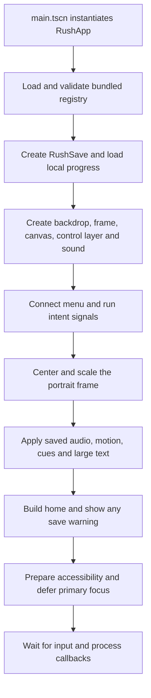

[Open the startup diagram](diagrams/architecture-3.svg).

The registry stores errors; startup assumes packaged content already passed the build validators.
There is no user-imported level format or complete runtime invalid-content recovery screen.
Content-validation failure must stop the development/release workflow.

## 5. Navigation and the player's complete journey

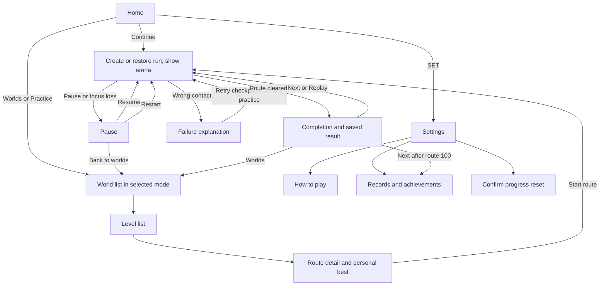

[Open the navigation diagram](diagrams/architecture-4.svg).

Standard runs return to standard browsing; practice/assisted runs return to practice browsing.
Menu back navigation pops `_history`, storing the prior screen and world. With no history it
returns home. Starting a run clears history. Android Back from home exits cleanly.

`MenuScreens.next_level()` prefers a saved **standard** resume, otherwise the first standard route
without a record, otherwise route 100. `start_level()` checks standard unlocks, applies assist mode,
and restores a checkpoint only when saved level **and mode** match. A practice/assisted snapshot
cannot silently become a standard attempt.

## 6. Input-to-feedback sequence

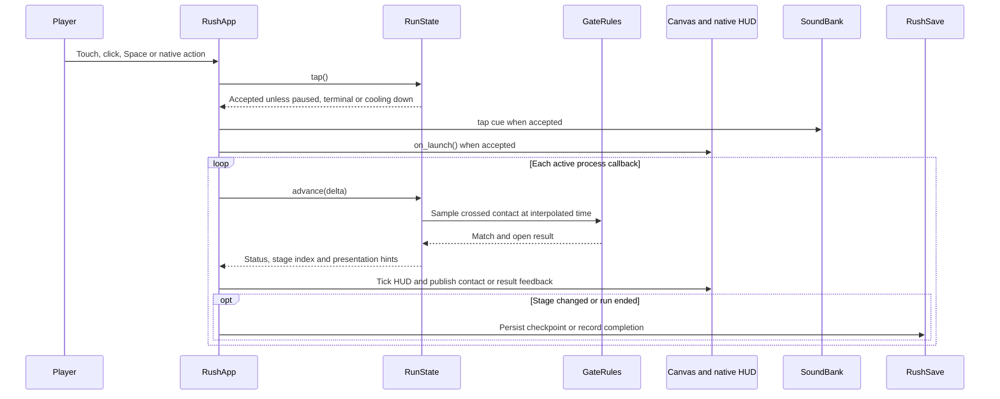

[Open the input sequence](diagrams/architecture-5.svg).

Mouse positions are transformed into the logical frame; touch events use `make_input_local()`.
Only the arena region triggers direct propulsion. Native buttons emit actions separately, and
mouse/touch emulation is disabled to avoid duplicated input paths. Consumed Space/arena events
are marked handled. Window size therefore does not change physics coordinates or touch rules.

## 7. Deterministic motion and the run state machine

The engine calls `_process(delta)`, and `RunState.advance()` subdivides that time into a fixed
**1/120-second** simulation step. The project also configures `physics_ticks_per_second=120`,
but the orb uses its own accumulator; it does not rely on rigid-body physics callbacks.

| Quantity | Implemented value / meaning |
|---|---|
| Fixed step | `1.0 / 120.0` game seconds |
| Gravity | `720.0` logical units per game second squared |
| Tap impulse | Velocity is set to `510.0` logical units per game second |
| Cooldown | `0.10` game seconds between accepted taps |
| Slow-time factor | Accumulated time multiplied by `0.7` |
| Catch-up cap | Each incoming frame contributes at most `0.5` seconds before slow-time scaling |
| Perch | Stage-local altitude is clamped to zero; returning to it costs no life |

Each step increments elapsed time, reduces cooldown, applies gravity, advances/clamps altitude,
then checks whether the leading edge crossed the next contact height. A tap **sets** velocity
rather than adding unlimited acceleration. Stage completion resets altitude and velocity for
the next perch. Time, taps and failures continue across stages and checkpoint retries.

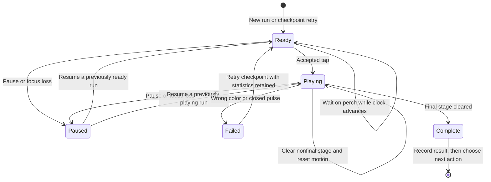

[Open the run-state diagram](diagrams/architecture-6.svg).

`ready` is live: waiting counts toward par time. Landing on the perch while already `playing`
does not reset the status to `ready`. Pause retains the prior status in `RushApp._pause_status`.
`retry()` restores checkpoint index/color and resets transient motion/contact/cooldown while
keeping cumulative statistics. Restart constructs a fresh run and clears the resume.

The simulation uses positive, stage-local distance toward the exit. For reverse stages,
`direction()` returns -1 and drawing mirrors the route. Numeric impulse/gravity equations stay
shared; there is no separately negated gravity/velocity simulation. This is the implementation
behind the player-facing description of reversed gravity.

## 8. Collision and gate rules

A color check only at a frame boundary can be unfair: the orb can hit a different segment between
the step's start and end. `GateRules.crossing_time()` interpolates the actual crossing instant:

```text
contact height = stage gap + contact index ? 54 - orb radius (11)
fraction       = clamp((height - previous altitude) / max(next altitude - previous altitude, 0.00001), 0, 1)
crossing time  = elapsed at end of step - step duration + fraction ? step duration
success        = pulse is open at crossing time AND sampled color equals orb color
```

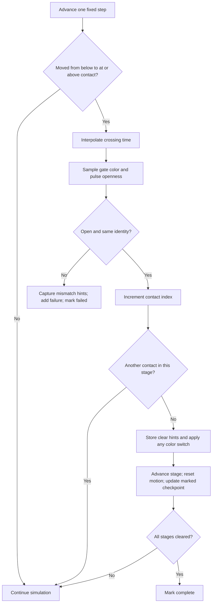

[Open the crossing-decision diagram](diagrams/architecture-7.svg).

| Kind | Sampler / extra condition |
|---|---|
| `ring` | Contact angle relative to rotating quarter segments, wrapped into four identities |
| `slide` | Sine-driven band position, divided into four identities |
| `pendulum` | Sine-driven swing with authored `drift` controlling span |
| `switch` | Slide-style match, then assign the authored next `color` after stage clearance |
| `pulse` | Color phase plus an open portion of each quarter-cycle, controlled by `width` |
| `chain` | Two contacts 54 logical units apart, with a phase offset for the second sample |
| `reverse` | Ring-style sampler with mirrored arena presentation |

Drawing and the HUD read the same stage parameters, elapsed time and `GateRules` sampler.
The assist's `next_window()` searches at 120 samples/second for up to 20 game seconds. It is an
observation aid; it does not authorize a crossing or replace live collision calculation.

## 9. Authored content and a concrete route

The registry sorts the ten files in [data/worlds](../data/worlds), parses world dictionaries and
flattens their `levels` arrays into sequential lookup. Runtime validation checks counts, IDs,
nonempty stages, known kinds, bounded gaps/speeds and duplicate stage signatures.
[validate_levels.py](../scripts/validate_levels.py) supplies the independent, more detailed audit.

| Definition | Fields |
|---|---|
| World | `id`, `name`, `theme`, `accent`, `levels` |
| Level | `id`, `name`, `world`, `subtitle`, `par`, `start_color`, `stages` |
| Stage | `kind`, `gap`, `speed`, `phase`, `offset`, `color`, `checkpoint`; optional `width`, `drift` |

`gap` and `drift` use logical distances. Shared phase is `time ? speed + phase`; `speed` is an
angular phase rate and `phase` is in radians. Identity indices and `offset` are 0?3; the UI shows
1?4. `color` matters when a switch changes the orb. `width` is a pulse duty fraction. Routes are
explicit content, not renamed runtime-generated templates.

For example, level 1 is **A Small Beginning**, starts as cyan/index 0, has a 32-second par and
three rings:

| Stage | Gap | Speed | Phase | Offset | Checkpoint after clearance |
|---|---:|---:|---:|---:|---|
| 1 | 145 | 0.60 | 0.00 | 0 | No |
| 2 | 155 | 0.65 | 1.15 | 1 | Yes |
| 3 | 150 | 0.70 | 2.30 | 2 | No |

After stage 2, the checkpoint points to index 2 (the third stage). A failure on stage 3 resumes
there; failures before earning that checkpoint return to stage 1. Accumulated time/taps/failures
remain. [LEVEL_DESIGN.md](LEVEL_DESIGN.md) explains all routes and gradual mechanic introduction.

## 10. Modes, scoring, unlocks and achievements

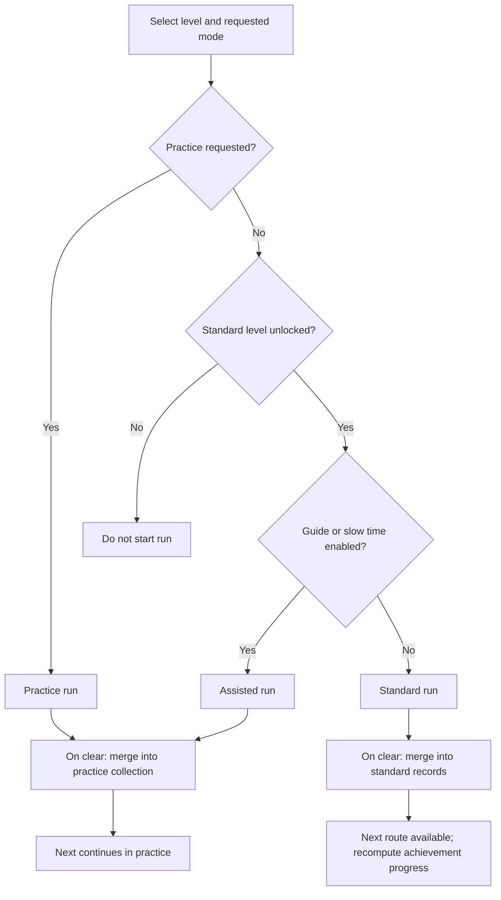

[Open the progression diagram](diagrams/architecture-8.svg).

`RushSave.unlocked(id)` accepts level 1 or a standard record for its immediately preceding level.
A standard world is available when its first level is unlocked. `RushApp` checks access at run
creation too; disabled controls are not the only check.

```text
stars = 3 when failures == 0 and elapsed <= par
        otherwise 2 when failures <= 2
        otherwise 1
score = max(100, stage count ? 1000 + stars ? 500 - floor(elapsed ? 10) - failures ? 200)
```

For positive elapsed time the implementation's integer conversion acts as the floor shown.
Taps are displayed but not directly deducted from score. `record_result()` independently retains
maximum stars, maximum score and minimum positive time, and increments completion count. Best
fields may come from different attempts. The controller clears resume before saving completion;
`_recorded` prevents repeated recording on later frames.

Achievements are computed from standard records, not stored award flags: 1/10/50/100 clears and
30/150/300 stars. Practice/assisted share the `practice` collection and cannot increase standard
totals. After assisted completion the UI labels Next **NEXT IN PRACTICE**; no standard unlock
is granted.

## 11. Save schema, trust boundary and recovery

The format is version 2. `updated_at` is written in UTC with a trailing `Z`.

| Field | Purpose |
|---|---|
| `settings` | Boolean sound/music/haptics/motion/cues/large-text/assist preferences |
| `records` | Standard results keyed by canonical level ID strings |
| `practice` | Practice and assisted results under the same record shape |
| `resume` | Checkpoint level/stage/color/mode plus time, taps and failures |
| `version`, `updated_at` | Schema version and latest successful write timestamp |

Records contain `stars`, `score`, `seconds`, `completions` and optional `legacy`. Resume is not a
serialization of the current airborne position. `RunState.snapshot()` records the **earned
checkpoint** and its color with cumulative statistics. Restore reconstructs the run, clamps the
checkpoint to the route, calls `retry()`, then restores statistics.

The loader rejects files over 1 MiB, malformed JSON, unsupported versions, unexpected keys, wrong
types, nonfinite/out-of-range numbers and invalid IDs/modes. Missing supported settings merge
with defaults; older valid v2 saves therefore acquire `large_text = false`.

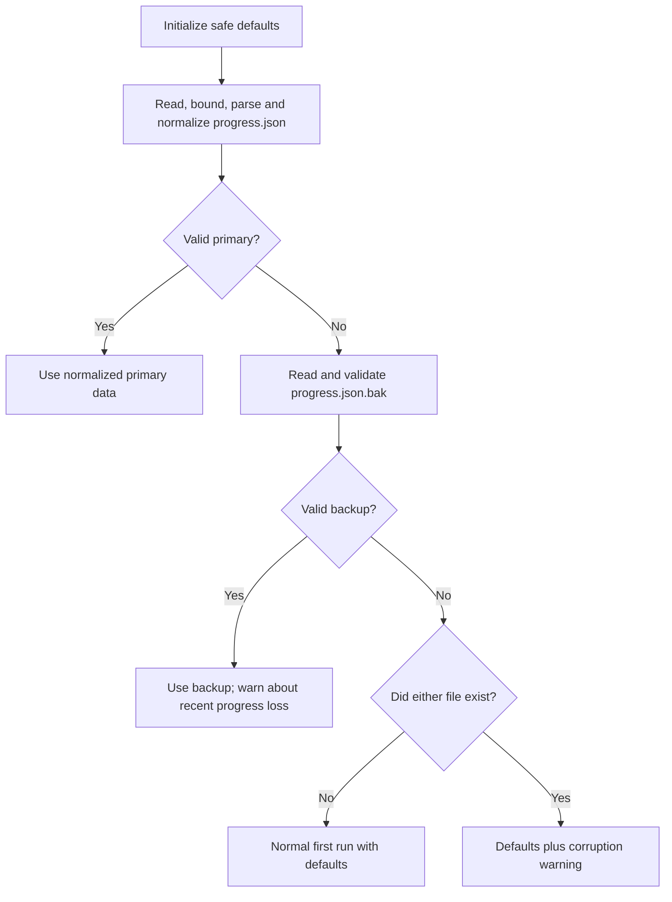

[Open the save-loading diagram](diagrams/architecture-9.svg).

Version 1 used `unlocked` plus settings. Migration creates `legacy` standard records for already
cleared levels with zero stars, score and unknown time. Access is preserved without inventing
measured achievements. Migration normalizes in memory; the next successful save writes v2.
Unknown versions are rejected, not guessed.

Local JSON is untrusted storage, not a competitive authority. There is no online leaderboard,
encryption or anti-tamper guarantee. No account or personal data is required.

## 12. Writes, failures and progress reset

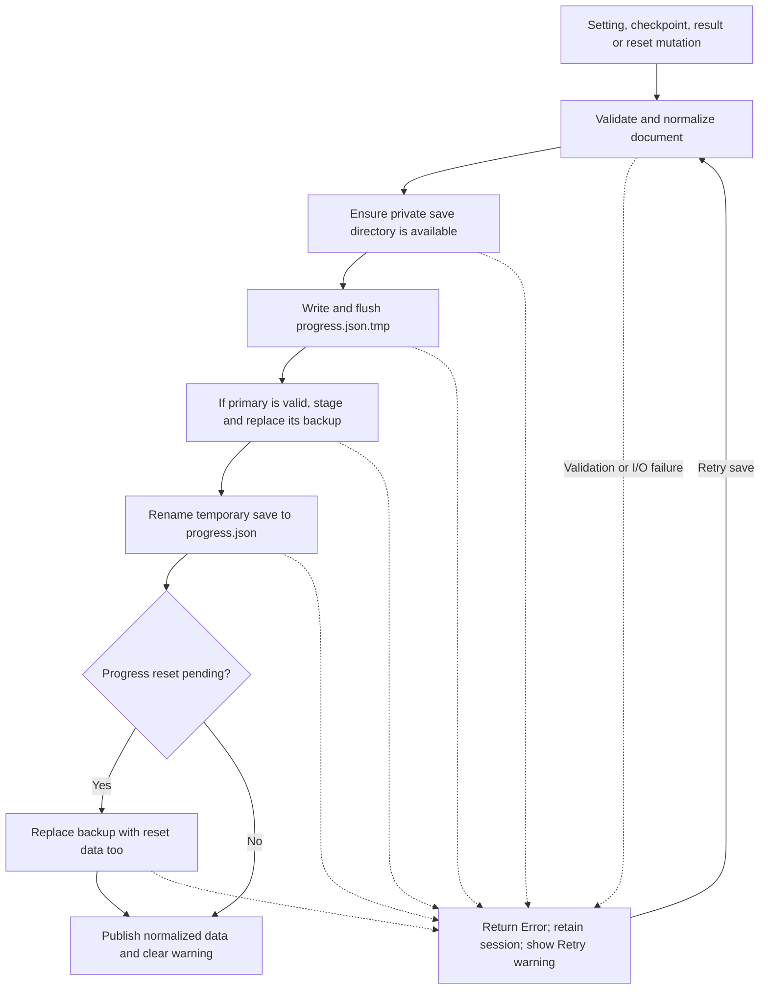

[Open the save-writing diagram](diagrams/architecture-10.svg).

Temporary writes and staged backups avoid blindly overwriting the only valid copy. This is a
local replacement/recovery design, not guaranteed transactional durability across every filesystem
or sudden power loss. Actual storage exhaustion and power-cut tests remain unperformed.

`RushApp` persists on stage progress, pause, failure, leaving gameplay and clean shutdown.
Settings save when toggled; result merging saves on completion. Warning banners retain Retry.
The live session remains usable on write failure, but recent progress is not durable until a
write succeeds. A valid backup may represent an earlier attempt.

Reset requires a `ConfirmationDialog`, preserves settings and clears records/practice/resume.
`_reset_pending` also updates the backup after a successful reset, so recovery cannot resurrect
records the player removed. Uninstall deletes progress and Android cloud backup is disabled.
There is no cloud sync or export/import UI.

## 13. Rendering, sound and accessibility

### Layout and visual identity

The portrait arena is 480 ? 900 logical units. `RushApp._layout()` uses the smaller viewport
scale factor and centers the frame, including in a landscape desktop window. `Backdrop` fills
the available window. `RushSkin` owns palette/font/control tokens; `Glyph` owns geometric icons.
There are ten dark world palettes and no light-theme setting. An unused `light_theme` save
default remains for compatibility.

`GatePainter` draws mechanical geometry. `GameCanvas` reads run state and clear/failure hints;
`Effects` owns disposable rings, sparks, shards and trails. Transitions can continue after the
simulation advances; they do not postpone applying an outcome. The controller delays the result
overlay 0.7 seconds for failure or 0.95 seconds for completion so feedback is visible. Reduced
motion removes that delay.

| Decorative resource | Normal cap | Reduced cap |
|---|---:|---:|
| Sparks | 90 | 30 |
| Shards | 28 | 14 |
| Rings | 6 | 3 |
| Trail points | 14 | 8 |

Thirty consecutive frames slower than 22 ms lower the budget and trim existing feedback.
One hundred twenty consecutive frames faster than 20 ms restore it. Between thresholds the
current quality remains. Reduced motion clears/suppresses decoration. Physics, matching, scores
and unlocks do not read the quality flag.

### Audio and haptics

`SoundBank` synthesizes 16-bit mono PCM at 22,050 Hz, caches effects and warms world notes. Four
voices serve effects and two alternate music notes. World variations change pitch/tempo of an
eight-note original phrase. Disabling sound/music stops its voices immediately; focus loss
suspends all voices. Haptic durations vary with tap/contact/clear/failure/completion and are
requested only on Android when enabled. A call does not prove a physical actuator vibrated;
actual listening and vibration were not tested on a phone.

### Accessibility presentation

`RushAccessibility.prepare()` assigns names/descriptions and explicit keyboard flow. Large text
builds `ReaderView` scrolling menus or `AccessibleHud` gameplay controls. Proxies forward to the
existing actions, preserving locks, modes and result ownership. Status labels describe route,
gate, orb identity and status. Saved reduced motion combines with a supported OS request.

Shape/number cues, focus and contrast-checked text tokens are implemented. Complete TalkBack/
Narrator gameplay and automatic OS font scaling are unverified. The Windows helper exposed only
the window frame in its accessibility tree. Tested 200% controls and thirteen rendered captures
are described in [accessibility verification](RELEASE.md#accessibility-verification).

## 14. Lifecycle and security

| Trigger | Implemented behavior |
|---|---|
| Focus lost | Pause a live run, persist checkpoint, suspend audio |
| Focus regained | Allow audio again; player still chooses Resume for a paused run |
| Android Back during gameplay | Pause/resume, or leave a terminal result for the appropriate world list |
| Back in a menu | Pop history, otherwise return home |
| Android Back at home / window close | Guard repeat quit, persist as applicable, drain suspended audio for 0.12 s, quit |
| Save error | Keep session in memory and show a persistent Retry warning |

`application/config/quit_on_go_back=false` lets the app own Android Back. Otherwise the engine
could close after the controller handled it; runtime verification found and corrected that
defect. `auto_accept_quit=false` similarly routes window close through clean shutdown.

Android requests vibration only. There is no network, storage/media, camera, microphone,
location or account permission. Save paths are fixed under the private user directory. Signing
files stay outside the project and app/source payloads. Editable local records are not evidence
of authenticated competitive performance.

## 15. How development was structured

Implementation grew through working slices. This explains each engineering purpose without
implying remote commits or human testing that did not occur.

| Slice | Built / refined | Check that made it reviewable |
|---|---|---|
| Rules and first route | Gate sampling, impulse, swept crossing, fixed-step motion | Correct/wrong colors and varied frame-rate replay |
| World 1 and local shell | Native home/play/settings, route schema, saves/checkpoints | Registry checks, real-file roundtrips, corruption and migration |
| Campaign expansion | Explicit worlds 2?10, mechanics and progression | 100 distinct authored layouts and actual-physics route search |
| Presentation refinement | Themes, gate painting, trails/shatter, chimes, result feedback | Rendered screens and every-world practice journeys |
| Accessibility and robustness | 200% layout, labels, adaptive budgets, timing perturbation | Operational large-text/contrast, retry and tolerance tools |
| Native release | Windows/debug/signed exports, privacy/signature audits, packaging | Signed emulator runs and extracted-source check/test/quality/build |

The first gameplay hypothesis was falsifiable: wrong-color contact should be detected even
between observed frames. Focused swept-crossing checks and later 30/60/120 FPS input replay
challenged that behavior. Separating collision rules before decorative work made those checks
possible. Later fixes addressed reset-backup recovery, visible save failures, honest assisted
Next behavior, Android Back and audio shutdown.

No automatic commits, branches or pushes were made under the project's working agreement.
The release identifies a verified working tree rather than a tagged remote commit. Slice names
do not establish physical-device or human test results.

## 16. Tests, route proof and evidence boundaries

| Layer | Tests / tooling | What it establishes |
|---|---|---|
| Content | Python validator and registry | Counts, IDs, parameters, kinds and distinct definitions |
| Pure rules | `test_gates.gd`, `test_run.gd` | Matching/windows, contacts, motion, cooldown, score and state boundaries |
| Solvability | `test_routes.gd`, `test_quality_routes.gd` | Production-input schedules for all 100 levels and frame-rate replays |
| Persistence | `test_save.gd`, UI failure tests | Real-file migration/recovery/write errors and separate records |
| Presentation/lifecycle | UI/world/effects/sound/shutdown suites | Control routing, layout, every-world journeys, budgets and lifecycle |
| Accessibility | `test_accessibility.gd` | 200% controls/persistence, locks, real clear/Next, focus metadata and token contrast |
| Timing/performance | Balance, precision and native render tools | Sampled launch tolerance, retry recovery and desktop rendering |
| Packaged runtime | Windows inspection and signed Android AVD | Specific exported touch, Back, offline and reinstall scenarios |

The route search tries launch schedules through production `RunState`; valid JSON alone is not
solvability proof. Schedules are stored in [route_audit.json](evidence/route_audit.json). Coverage
runs in a disposable copy, includes every production script, checks hashes and rejects collector
omissions. It uses schedule replay while the normal suite still performs the expensive search.

The recorded release passes 12 native suites and 52,697 sampled assertions. Unique planned
source-line/branch coverage is 94.69%/90.84%. The collector's mixed tracking-point rate is 92.90%;
it is not independent statement/function coverage. Those metrics and a SonarQube GDScript gate
are unsupported; see [quality gates](RELEASE.md#quality-gates).

Desktop stress rendering measured approximately 59.75 FPS on the recorded host. This is not
midrange Android performance evidence. Physical-phone checks were skipped at the owner's request.
Human balancing, accessibility-user playtests and hosted CI are unverified. Legacy emulator
`swiftshader_indirect` displayed a blank canvas; the unchanged APK rendered with `-gpu host`.
[RELEASE.md](RELEASE.md) preserves failed and successful runtime evidence.

## 17. Build, package and release flow

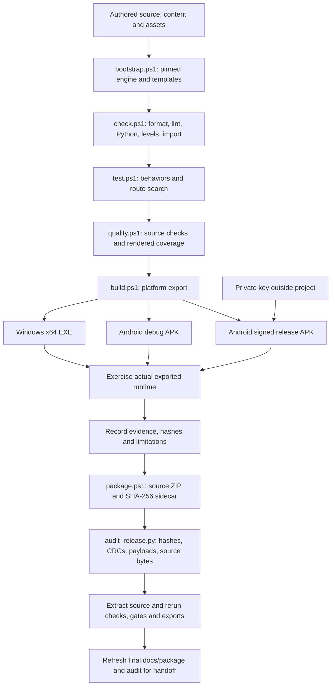

[Open the release-pipeline diagram](diagrams/architecture-11.svg).

Commands and outputs are in the [README](../README.md#develop-verify-and-build).
`build.ps1 -Target All` exports Windows plus Android debug. `-SignedAndroidRelease` changes the
Android portion to release signing through environment variables or protected local material.
Run the debug export separately when the full audit needs both APKs.

The signing helper reuses complete material and refuses an incomplete key/password pair. Debug
and release certificates differ; Android cannot update an install signed with the other identity.
Keys never belong in Git or source archives, and same-key updates must retain the release key.
Store AAB publication and Windows code signing have not been performed.

`package.ps1` includes source, data, assets, tests, scripts, docs and CI, excluding caches,
private tooling, logs, build output and temporary visual probes. The audit checks both APKs for
ten worlds/100 levels/expected ABIs and checks archive bytes against working files. Sidecars
identify exact artifacts; rebuilt binaries need not be byte-identical.

[verify.yml](../.github/workflows/verify.yml) configures Windows bootstrap, checks, tests, quality,
Windows/debug exports and artifact upload. It does not inject the private release key. A workflow
file is not hosted execution evidence. The fresh-copy release check used new Python environments
on the same host with its installed engine/JDK/SDK.

### Maintaining these diagrams

Mermaid blocks in this file are the source of truth; SVGs in `docs/diagrams/` are generated views.
The [Mermaid CLI](https://github.com/mermaid-js/mermaid-cli) can render all Markdown blocks. For
example, with documentation-only Node tooling installed in the ignored `.tools` directory:

```powershell
npm.cmd install --prefix .tools/docs-mermaid --ignore-scripts --no-audit --no-fund @mermaid-js/mermaid-cli@12.2.0
.\.tools\docs-mermaid\node_modules\.bin\mmdc.cmd -i docs/ARCHITECTURE.md -o docs/diagrams/architecture.md -p .tools/docs-mermaid/puppeteer.json
Remove-Item -LiteralPath docs/diagrams/architecture.md
```

Because install scripts are disabled, supply `puppeteer.json` with an `executablePath` pointing
to your installed Chrome/Chromium. The command generates `architecture-1.svg` through
`architecture-11.svg` plus a temporary Markdown companion. Remove that generated companion as
shown above; this guide remains the editable source. The app itself has no Node dependency.

## 18. Change the app without breaking its contracts

| Desired change | Start here | Validate the behavior that could break |
|---|---|---|
| Tune a route | World JSON and LEVEL_DESIGN.md | Structure, route search/replay, launch tolerance and actual play |
| Add a gate kind | Rules, registry/validator, painter and help/glyph copy | Matching/open/contact edges, readable rendering and affected routes |
| Change motion/cooldown | `RunState` | Swept crossings, frame-rate schedules, retry and all 100 routes |
| Change records/unlocks | `RushSave`, `RushApp._finish_run` | Best-field merge, mode isolation, stars, unlock graph and achievements |
| Add a preference | Save defaults/validation, settings UI, `_apply_settings` | Older v2 defaults, operational toggles, reload and accessible views |
| Change save format | Schema/normalization/migration | Legacy fixtures, malformed input, recovery, write errors and reset backups |
| Change layout | Native builder, skin and ReaderView | Keyboard/touch/focus, 320x600/portrait/landscape and 200% text |
| Add feedback | Canvas/effects/audio | Bounds, reduced motion, quality changes, focus suspension and actual output |

For each change, state a behavior that could be wrong, run the focused check, then broaden checks
as justified by the change. Do not let rendering/assist code award standard progress, mutate
content from drawing, weaken thresholds, or substitute test doubles for runtime evidence. Update
relevant evidence when behavior changes.

Read [known limitations](RELEASE.md#known-limitations) before promising wider device, accessibility or
distribution support. This guide explains the implemented system and its verified boundaries.


## 19. Design rationale and reference record

This preserves the original 2026-11-03 design research and intent. Runtime behavior in the
earlier architecture sections and release measurements take precedence over initial targets.
Duplicated navigation/wireframes, campaign tables and obsolete draft particle limits have been
replaced by their implemented equivalents above and the dedicated level catalogue.

### Product brief and intended audience

The player propels one orb through moving spectral gates, reading timing and color rather than
steering around hazards. A matching contact opens the route; a mismatch ends the attempt with
an immediate explanation and a one-action retry. Ten authored worlds introduce mechanics gradually.
The game must work entirely offline, without an account or permission onboarding.

Success means a new player can start level 1 from the game menu, discover the tap rhythm, understand
the first mismatch, retry, finish and see durable progress. Completionists can inspect stars,
best scores and times. Practice and assists remain visibly separate from standard achievements.

| Persona | Core job | Design consequence |
|---|---|---|
| Brief-session player | Resume and enjoy a short timing challenge | Continue is the main action; fast retry; pause on interruption |
| Precision completionist | Master authored routes and improve records | Readable level map, real records, explicit star criteria |
| Player using assistance | Read gates and learn safely | Numbers/shapes, optional guide and slow time, reduced decoration |

The primary device is a portrait touch phone. Keyboard and mouse support the desktop preview.
Content density stays low in play and moderate in world/level selection. Input feedback must start
on the input frame; no transition may postpone the actual impulse or retry.

### Reference research

The following current pages/repository were opened through web tools on 2026-11-03. Research was
**text-only**: no browser screenshots or visual measurements were taken. These are references for
principles, not assets or layouts to copy. No web animation library is a runtime dependency.

| Reference | Observed pattern / suitability | Strength / weakness | License | Accessibility / performance |
|---|---|---|---|---|
| [Realtime Colors](https://www.realtimecolors.com/) | Semantic text/background/primary/secondary/accent roles; useful for palette discipline | Contextual palette and contrast preview; generic website sections do not fit game navigation | Generated colors may be used commercially; website materials show CC BY-NC-ND, so copy no source/assets | Measure game contrast separately; no runtime dependency |
| [Motion accessibility](https://motion.dev/docs/react-accessibility), [repository](https://github.com/motiondivision/motion) | Preserve useful state feedback while reducing large transforms and parallax | Clear reduced-motion guidance; React APIs are unsuitable for this native engine | Core repository MIT; premium materials separate | Apply principles through native tweens; no extra package or rendering layer |
| [React Spring](https://www.react-spring.dev/), [license](https://github.com/pmndrs/react-spring/blob/main/LICENSE) | Responsive and interruptible feedback | Natural-motion rationale; React would introduce an unnecessary runtime | MIT | Immediate input, short native feedback, bounded particles |
| [21st.dev](https://21st.dev/) | Component categories and explicit button/navigation states | Interaction-state reference; website heroes and shaders do not suit the core task | No blanket component license verified; no code/assets reused | Native controls with labels and focus; no imported shader cost |

Godly redirected to recent.design and could not be fetched. The initial Motion `/docs/accessibility`
URL failed; the correct `/docs/react-accessibility` page succeeded. No findings are claimed from
unavailable pages. Source-derived summaries above are deliberately concise.

### Visual direction

**A — Prism Observatory, selected.** Ink-navy space, warm off-white typography, precise orbital
geometry and four bright spectral colors. Thin navigation rules and restrained stars support
the feeling of exploring a constructed optical instrument. The game gates provide the spectacle.

**B — Chromatic Paper Lab.** Warm ivory surfaces, flat print-like shapes and strong dark outlines.
This is friendly and readable, but bright gates have less separation and the tone fits night play
less well. It remains an alternative, not an implemented second theme.

Direction A supports fast timing decisions without competing decorations. All artwork is original
engine-drawn geometry; no borrowed game artwork, trademarks, sounds or exact layouts. Native Godot
animation preserves a small dependency surface and a consistent input/rendering loop.

### Tokens, typography and layout intent

The logical canvas is **480 × 900**, with **32-unit horizontal content margins**. Maintain at least
64 × 64 logical units for touch controls and increase important actions to 72–80 units high.
Use spacing steps 4, 8, 12, 16, 24, 32 and 48. Thin separators describe structure; avoid framing
every sentence in a card. Repeated level tiles may use clear bounded surfaces.

| Token | Color | Purpose |
|---|---|---|
| Background | `#0B1020` | Main playfield/menu field |
| Surface | `#131C30` | Controls, dialogs and level tiles |
| Text | `#F5F2E8` | Primary readable text |
| Muted | `#9BA7BF` | Supporting labels and records |
| Rule | `#26344F` | Nonessential grid and separators |
| Spectrum 1 | `#58E1DF` | Cyan; circle / 1 |
| Spectrum 2 | `#FF8278` | Coral; triangle / 2 |
| Spectrum 3 | `#F4CA64` | Gold; diamond / 3 |
| Spectrum 4 | `#B69AFF` | Iris; square / 4 |

Calculated sRGB relative-luminance contrast against Background: Text 16.90:1, Muted 7.82:1,
Cyan 11.95:1, Coral 7.86:1, Gold 12.15:1, Iris 8.16:1. These mathematical checks do not replace
device testing or assessment of thin lines, focus rings, mixed backgrounds and color deficiencies.
Never use the low-contrast Rule color for necessary text.

Suggested logical type scale: 48 title, 32 screen heading, 24 action/body emphasis, 20 body,
18 metadata. Use a legible bundled face with its license; use stable tabular-looking digits for
timers and records where available. Long level names must wrap or fit without covering controls.

At narrow/short viewports, preserve the arena and scroll menu content rather than shrinking touch
targets. Desktop landscape centers the portrait arena with quiet side framing. Android requests
portrait orientation; actual cutout, gesture-bar and text-scaling behavior needs hardware QA.


### Interaction principles and acceptance

Keep the operational game menu and real save-derived progress ahead of explanatory marketing.
Inputs apply immediately; decorative feedback does not defer an impulse or retry. Failure
explains the contact, checkpoint retry is prominent, and assisted records are visibly separate.
Vibration/audio must not be required to understand an outcome. Use the same four color/shape/
number identities in every world, even when the world palette changes.

The original interaction targets were roughly 80-120 ms button feedback and 160-220 ms fades;
these are design targets, not measured phone latency. The implemented effects caps in section 13
supersede the early 48-particle draft. There is no imported animation framework, raster-background
dependency, decorative strobing or network asset request during play.

Review first run, locked/unplayed/completed routes, standard/practice/assisted results, long
names, all-complete progress, save warnings, corruption/migration, reset confirmation and
background/resume. Capture actual home/selection/play/pause/failure/completion/settings states
at small portrait, tall phone and landscape framing. Verify keyboard focus, Space/tap separation,
Back, retry, color cues, large text and reduced motion. The release guide owns which checks
actually passed and which phone/screen-reader/human tests remain unverified.
